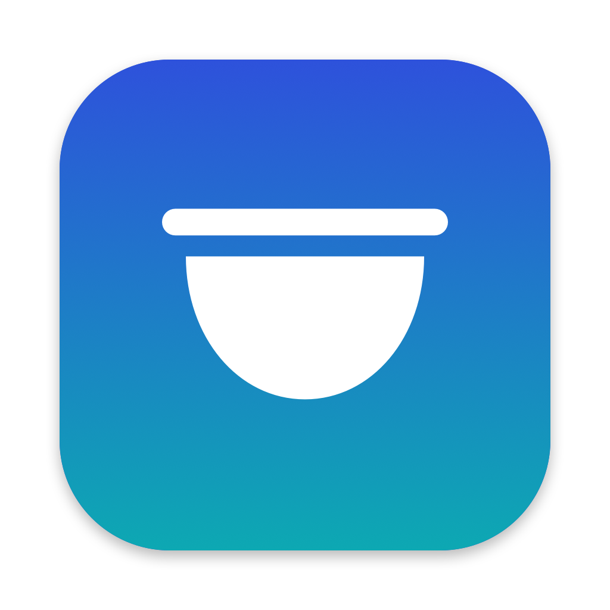

<p align="center">
  
</p>

<h1 align="center">Brim</h1>

<p align="center">
  <b>A free, open-source Mac menu bar app for developers who live in Claude Code.</b><br>
  Run several Claude Code accounts side by side, keep a dev Mac's memory in check,<br>
  and get a full system monitor and Mac toolkit in one place.
</p>

<p align="center">
  <a href="LICENSE"></a>
  
  
  
  <a href="https://github.com/eliseorobles/brim/actions/workflows/ci.yml"></a>
</p>

<p align="center">
  <a href="https://eliseorobles.github.io/brim/">Website</a> ·
  <a href="#build-from-source">Build from source</a> ·
  <a href="#faq">FAQ</a> ·
  <a href="docs/PRIVACY.md">Privacy</a>
</p>

---

**Brim is a free, open-source macOS menu bar app for Apple Silicon Macs.** It
lets one person use several Claude Code accounts on the same Mac (each one's
usage at a glance, automatic account picking, and moving a conversation to
another account when one hits its limit), ends leftover dev processes when
memory gets tight, and bundles a system monitor, Port Manager, Kill Process,
Cleaner, Uninstaller, Homebrew manager, app updates, clipboard history, keep
awake and a Dynamic Island. It has no account, no telemetry and no
subscription. Brim is written in Swift, licensed GPL-3.0-or-later, and based on
[Vorssaint](https://github.com/vorssaint/vorssaint-utils).

## Why Brim

I pay for more than one Claude subscription, and each one renews its weekly
limit on a different day. Switching between them meant signing out and back
in, losing track of which account had room, and restarting conversations.
Meanwhile, long agent sessions left dev servers, test runners and simulators
behind, which slowly filled the Mac's memory.

Brim fixes both from the menu bar, next to the system tools I reach for every
day. *(Eliseo Robles, author)*

## Features

Each feature can be turned off in Settings › Features. A feature that is off
stops loading and asks for no permissions.

### Claude Code accounts

- **Several accounts, no signing out.** Each Claude Code account gets its own
  config folder (`CLAUDE_CONFIG_DIR`), signed in once by Claude Code itself.
  Brim signs each one in through a private browser window, so a browser that's
  already signed in to claude.ai can't approve the wrong account.
- **Usage at a glance.** Each account's weekly limit, its model-specific
  limits and when they renew, in the menu bar panel and a Claude Code status
  line.
- **Shell commands.** `claude` starts on the account Brim picks (the one whose
  weekly limit renews soonest), `cc <account>` starts on a named one, and `cx`
  continues your last conversation on another account after `/exit`.
- **Conversations follow you.** Every account folder holds a copy of every
  conversation, so `/resume` lists them all and a conversation can continue on
  any account.
- **MCP servers per repo.** Every MCP server is on everywhere by default; you
  can switch one off for a single repo, or add servers that only one repo uses.
- **Hands off your credentials.** Brim never reads, copies or refreshes a
  Claude sign-in. Claude Code keeps its own credentials for each folder.

```sh
claude                  # start on the account with the soonest weekly renewal
cc work                 # start on the account labelled "work"
# ...the account hits its limit: /exit, then
cx                      # continue the same conversation on another account
cx --to personal        # ...or on a specific one
```

### Memory

- Shows memory pressure, swap and compressed memory, plus what is actually
  holding memory: leftover dev process groups (dev servers, test runners,
  watchers whose editor or terminal is gone) and apps unused for hours.
- Three levels: **Inform** (the panel lists it), **Notify** (one notification
  per memory-tight episode, naming what holds the memory) and **Automatic**
  (only while memory is tight, and only orphaned dev process groups, checked
  again just before each one is ended).
- A runaway brake ends a process whose memory footprint explodes (for
  example, a test runner that grows by hundreds of gigabytes in minutes) and
  logs what it did.
- Spots the known macOS `fseventsd` memory leak and tells you how to clear it.

### System monitor

CPU, GPU, memory, network, disk and power in the menu bar and panel, with
alerts that ignore short spikes. Connected devices with battery levels, and
fan control through a privileged helper.

### Mac tools

| Tool | What it does |
|---|---|
| Port Manager | Lists listening ports and the process behind each one, and ends it |
| Kill Process | Finds and ends processes, including ones that won't quit |
| Cleaner | Finds caches, logs, developer files, old device backups, app leftovers and forgotten screenshots, and moves what you pick to the Trash |
| Uninstaller | Removes an app together with the files it leaves around the system |
| Homebrew | Manage formulae and casks, with Homebrew's public install counts |
| App Updates | Checks your apps' own update feeds, the App Store and Homebrew casks for new versions |

### Clipboard, keep awake and the Dynamic Island

- **Clipboard history** with search, pinned items, ⌘1 to ⌘9 pasting, images
  and files, and paste as plain text. Content its source app marks as
  concealed (password managers) is never recorded.
- **Keep awake**, including closed-lid mode.
- **Dynamic Island** around the notch, with Controls, Clipboard, System and AI
  agents pages (Claude Code and Codex usage, plus a speed test).

## Requirements

- macOS 14 Sonoma or newer
- An Apple Silicon Mac (M1 or later)

## Build from source

Brim builds with `build.sh` and plain `swiftc`: no Xcode project and no package
dependencies. You need the Xcode Command Line Tools (`xcode-select --install`).

```sh
git clone https://github.com/eliseorobles/brim.git
cd brim
BRIM_SIGN_IDENTITY=- ./build.sh --dev --install   # builds and installs "Brim (Developer)" in /Applications
```

`BRIM_SIGN_IDENTITY=-` signs the build ad hoc. To keep macOS privacy grants
across rebuilds, set it to your own "Apple Development" or "Developer ID
Application" certificate (its full name or SHA-1, from
`security find-identity -v -p codesigning`). Fan control only works in builds
signed by the maintainer's team, because the privileged fan helper accepts only
an app with the same team signature. Everything else works in your own build.

More commands (tests, selftests, the release build) are in
[CONTRIBUTING.md](CONTRIBUTING.md). Troubleshooting is in
[docs/TROUBLESHOOTING.md](docs/TROUBLESHOOTING.md).

## Permissions

Brim asks only for what the features you turn on need.

| Permission | Used by |
|---|---|
| Accessibility | Keep awake (mouse jiggle), paste as plain text, the island's clipboard page, recording a shortcut |
| Full Disk Access | Cleaner, Uninstaller |
| Files and Folders | Cleaner (WhatsApp downloads, forgotten screenshots) |
| Notifications | Cleaner, App Updates, monitor alerts, Claude accounts, Memory |
| Automation (Finder) | Cleaner and Uninstaller, to move items to the Trash |
| App Management | Homebrew, App Updates |
| Bluetooth | Connected devices (peripheral battery levels) |
| Administrator password | Installing the fan helper; the optional password-free closed-lid rule |

Details are in [docs/PERMISSIONS.md](docs/PERMISSIONS.md).

## Privacy

Everything Brim reads stays on the Mac. It has no account, no analytics, no
crash reporting and no server of its own. It uses the network only when a
feature you turned on needs it: App Updates asks your apps' update feeds, the
App Store and Homebrew for new versions; Homebrew runs `brew`; the speed test
downloads from Cloudflare; Claude and Codex usage come from `claude` and
`codex` themselves. See [docs/PRIVACY.md](docs/PRIVACY.md).

## Uninstalling

Settings › Advanced › Uninstall Brim completely removes the app and everything
it set up. It first takes back the Claude Code status line and shell
integration, then deletes Brim's Claude accounts state in `~/.config/brim/claude`
(`~/.config/brim-dev/claude` for the Developer app), and the `brim` or
`brim-dev` folder above it when nothing else is in it. From a checkout,
`Tools/uninstall.sh` does the same (`Tools/uninstall.sh --dev` for the
Developer app).

## FAQ

**What is Brim?**
Brim is a free, open-source macOS menu bar app for Apple Silicon Macs. It
combines a Claude Code multi-account manager, a memory manager for development
machines, a system monitor and Mac utilities such as a Port Manager, Cleaner and
Uninstaller.

**How do I use more than one Claude Code account on the same Mac?**
Give each account its own Claude Code config folder with `CLAUDE_CONFIG_DIR`
(for example `~/.claude-work`) and sign in to each one once. Brim sets this up
for you, shows every account's usage, and adds the `claude`, `cc` and `cx`
shell commands to start on, or move between, accounts without signing out.

**Does Brim read or store my Claude credentials?**
No. Each account's sign-in stays with Claude Code in that account's own folder
and Keychain item. Brim never reads, copies or refreshes a token.

**How do I continue a Claude Code conversation on another account when I hit a usage limit?**
Type `/exit`, then run `cx`. Brim continues your latest conversation in that
folder on another account with room, or on the one you name with
`cx --to <account>`.

**How do I see Claude Code usage limits for each account?**
Brim's menu bar panel and its Claude Code status line show each account's
weekly limit, model-specific limits and when they renew.

**How do I free memory used by leftover dev servers and test runners on a Mac?**
Brim's Memory module lists orphaned dev process groups (ones whose editor or
terminal is gone) with their memory, and ends them with one click, or
automatically while memory is tight.

**How do I find which process is using a port on macOS?**
Open Brim's Port Manager to see every listening port and the process behind it,
and end it from there. Without Brim, run `lsof -nP -iTCP:3000 -sTCP:LISTEN`.

**Is Brim free? Does it collect data?**
Brim is free and open source under GPL-3.0-or-later. It has no telemetry, no
analytics and no account.

**Does Brim run on Intel Macs?**
No. Brim needs an Apple Silicon Mac and macOS 14 or newer.

**How is Brim related to Vorssaint?**
Brim is a hard fork of [Vorssaint](https://github.com/vorssaint/vorssaint-utils),
an open-source macOS menu bar toolkit. It keeps Vorssaint's monitor and Mac
tools, removes the window, dock, mouse, keyboard and sound features, and adds
the Claude Code accounts and Memory modules. As Vorssaint's
[trademark terms](TRADEMARKS.md) require, it has its own name, icon, bundle ID
and signing identity.

**Is Brim made by Anthropic?**
No. Brim is an independent project and is not affiliated with or endorsed by
Anthropic. Claude and Claude Code are trademarks of Anthropic.

## Contributing

Issues and pull requests are welcome. Read [CONTRIBUTING.md](CONTRIBUTING.md)
first, and report security problems as described in [SECURITY.md](SECURITY.md).

## Credits and license

Brim is built by [Eliseo Robles](https://eliseorobles.com)
([@eliseorobles](https://github.com/eliseorobles)), Robles Consulting LLC.

Brim is a modified version of Vorssaint, © 2026 Vorssaint, GPL-3.0-or-later.
Brim's changes began on 2026-11-12 and are © 2026 Robles Consulting LLC. Brim
is distributed under the same license, GPL-3.0-or-later: see
[LICENSE](LICENSE). The Vorssaint name and branding belong to its maintainer
([TRADEMARKS.md](TRADEMARKS.md)).
